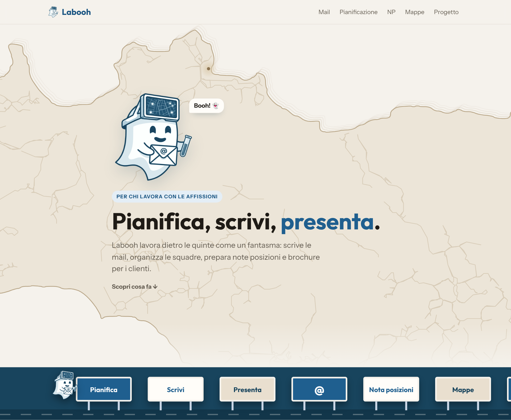
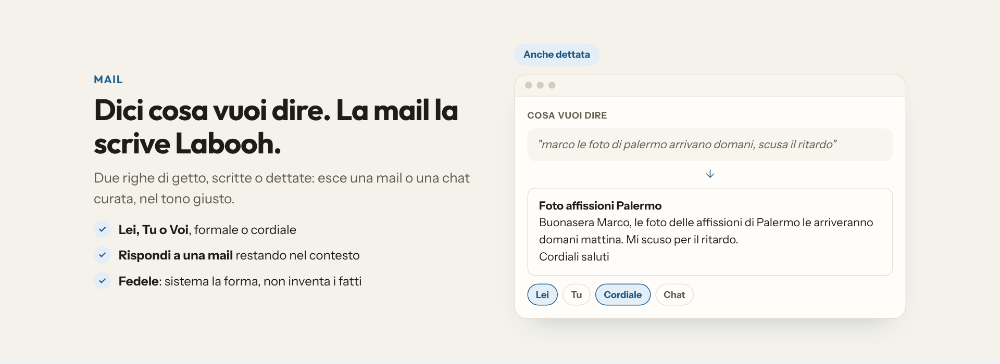
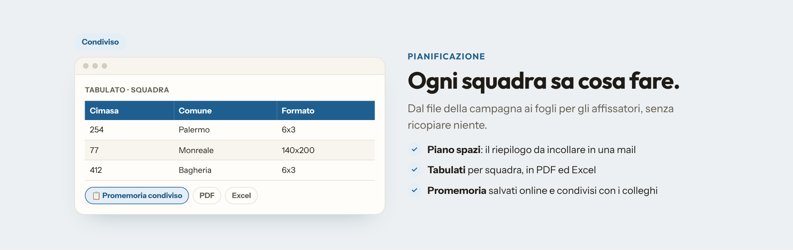
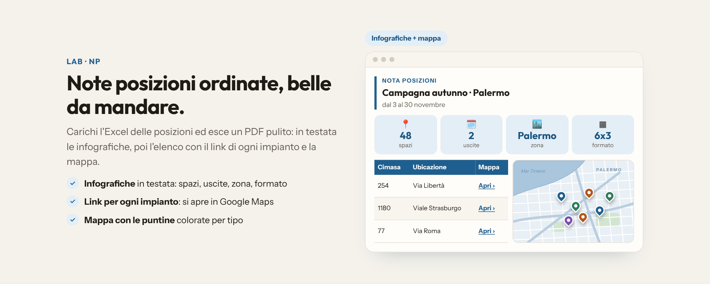
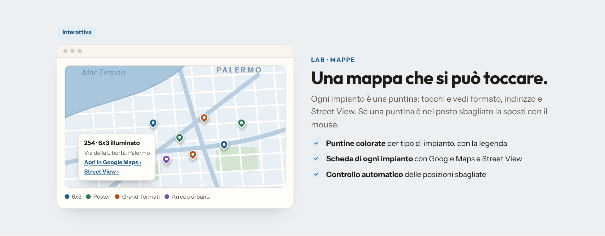
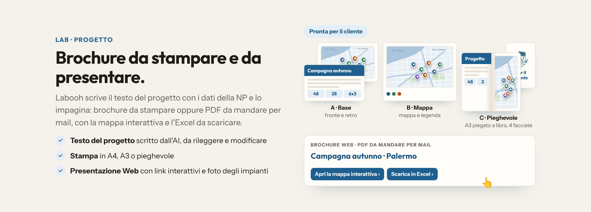
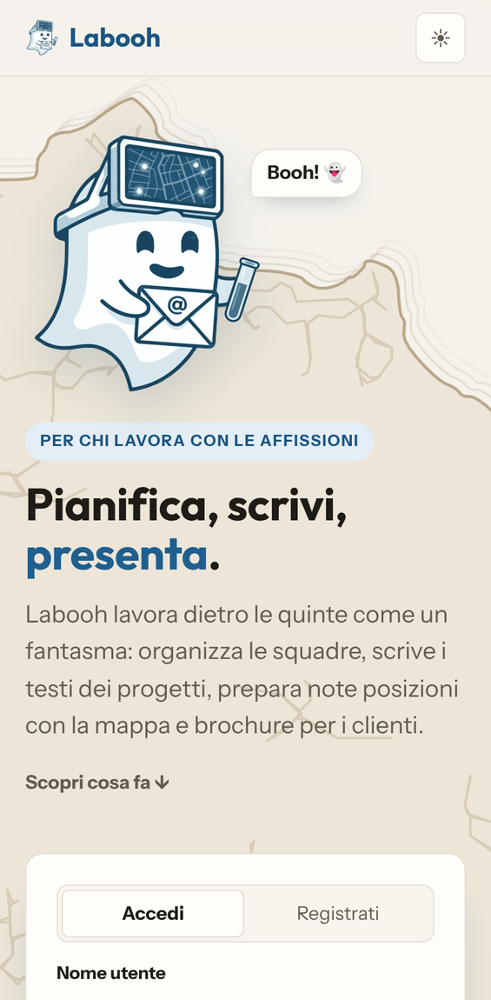

# Labooh 👻

**Pianifica, scrivi, presenta.** Un'app web che ho ideato e costruito per il mio lavoro nelle affissioni pubblicitarie: organizza le squadre, prepara le note posizioni con la mappa, scrive i testi dei progetti e impagina le brochure per i clienti.

👉 **Guardala dal vivo:** [labooh-app.onrender.com](https://labooh-app.onrender.com)
(la pagina iniziale si apre senza password; l'app vera e propria è ad accesso riservato)

> 🚧 **Cantiere aperto.** Labooh la uso ogni giorno e funziona già bene, ma non è finita: cresce con chi la usa e ogni settimana si aggiunge o si migliora qualcosa.

---

## Perché l'ho fatta

Nel lavoro delle affissioni tante ore se ne vanno in attività ripetitive: ricopiare elenchi di posizioni da un Excel all'altro, controllare a mano che ogni impianto sia nel punto giusto della mappa, preparare i fogli per ogni squadra, scrivere mail e presentazioni per i clienti. Labooh raccoglie tutto questo in un solo posto e fa il lavoro noioso, così resta più tempo per i clienti.

## Cosa fa

**✉️ Mail** — scrivi o detti due righe di getto e l'AI le trasforma in una mail o in un messaggio chat curato: forma (Lei, Tu, Voi) e tono a scelta, risposta a una mail ricevuta, senza inventare fatti.

**🗓️ Pianificazione** — piano spazi pronto da incollare in una mail, tabulati di smistamento per ogni squadra in PDF ed Excel, promemoria salvati online e condivisibili con i colleghi.

**📍 NP · Note posizioni** — da un file Excel di posizioni a un PDF ordinato con infografiche, elenco degli impianti con il link di ognuno e mappa. Controllo automatico delle coordinate: trova i punti in mare, fuori dal comune o doppi e propone la correzione.

**🗺️ Mappe** — mappa interattiva con le puntine colorate per tipo di impianto; si tocca una puntina per vedere la scheda (formato, indirizzo, Street View) e la si sposta con il mouse se è nel posto sbagliato.

**🧪 Progetto** — il testo del progetto scritto dall'AI con i dati veri della campagna, da rileggere e modificare, e la brochure: da stampare (A4, A3, pieghevole) oppure in PDF da mandare per mail, con la mappa interattiva, l'Excel da scaricare e le foto degli impianti.

## Come è fatta

| | |
|---|---|
| Interfaccia | React + TypeScript (Vite), pensata per PC e telefono, tema chiaro e scuro |
| Server | Node.js con Express |
| Database | PostgreSQL su Supabase (server nell'Unione europea) |
| Intelligenza artificiale | modelli Google Gemini, con scelta automatica del modello più adatto |
| Mappe | MapLibre, OpenFreeMap e OpenStreetMap |
| Documenti | PDF ed Excel generati direttamente nel browser |
| Messa online | Render, con una versione di prova e una versione vera |
| Automazioni | GitHub Actions: sveglia del server ogni mattina e copia di sicurezza del database ogni settimana |
| Account | accesso personale con approvazione, permessi per sezione, sessioni a scadenza, privacy e termini d'uso (GDPR) |

Tutto gira su servizi con piano gratuito.

## Il mio ruolo

Labooh è un progetto personale, nato e cresciuto nel tempo libero. L'ho **ideata, progettata e guidata io**: ho deciso ogni funzione, il flusso di lavoro, la grafica e il fantasmino, e ho provato ogni versione sul lavoro vero, con file e campagne reali. Il codice l'ho sviluppato **insieme a un assistente AI (Claude)**, lavorando come un responsabile di prodotto: spiegare cosa serve, provare, correggere, decidere.

Il codice sorgente resta privato.

## Cosa arriva

- note personali che seguono l'account
- storico delle mail scritte
- foto delle posizioni che restano anche ricaricando la pagina
- e, come sempre, le idee di chi la usa

---

Contatti: **Filippo Gulisano** · labooh.ai@gmail.com

Gli esempi nelle immagini (clienti, squadre, numeri) sono inventati.
