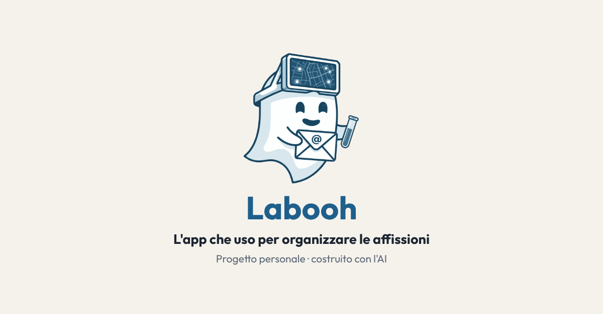
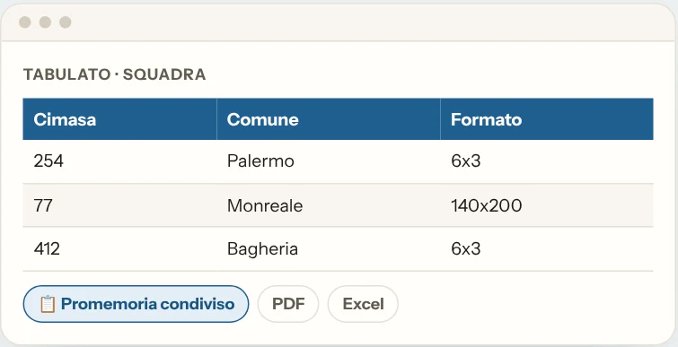
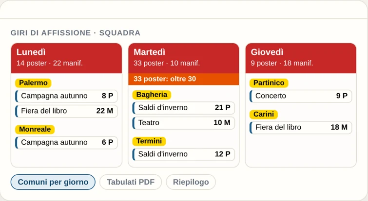
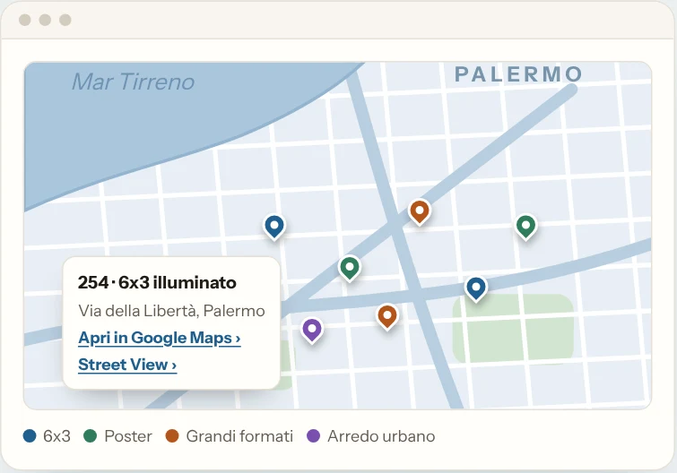
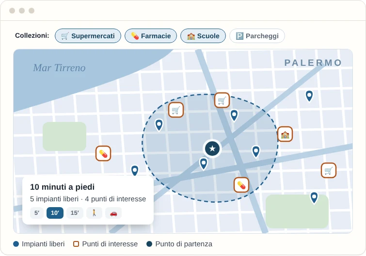
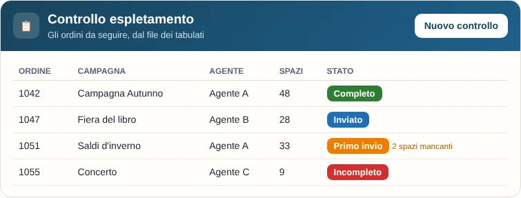
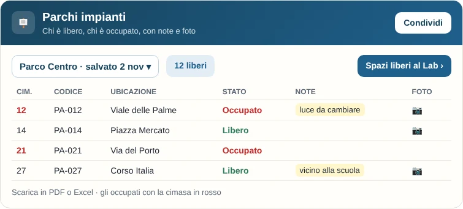
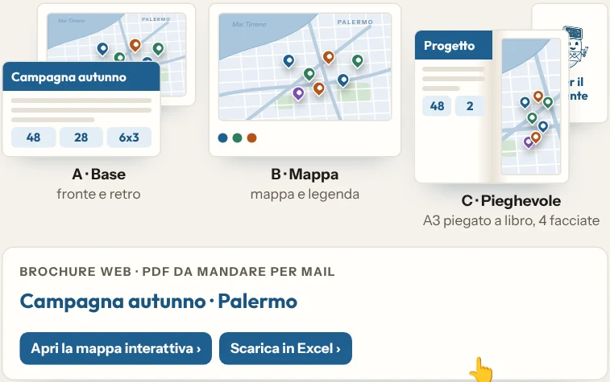

# Labooh 👻

**L'app che uso per organizzare le affissioni pubblicitarie.**
Progetto personale: l'ho ideata e costruita io, con l'aiuto di un'intelligenza artificiale (Claude).

👉 **Presentazione:** [labooh-app.github.io/labooh-presentazione](https://labooh-app.github.io/labooh-presentazione/)

L'app è ad accesso riservato: il codice e i dati di lavoro non sono pubblici.
Vuoi usarla quando apre? Lascia la tua richiesta su [labooh-app.onrender.com](https://labooh-app.onrender.com/) (può metterci un minuto ad aprirsi).

> 🚧 **Cantiere aperto.** La uso ogni giorno e ogni settimana migliora qualcosa.

## Il problema

Coordino le affissioni in tutta la Sicilia occidentale: più di 60 campagne ogni 14 giorni, sei squadre, agenti e uffici da tenere insieme. Molte ore se ne andavano tra Excel, telefonate e fogli per le squadre. Invisibile ma sempre al lavoro: Labooh fa questo lavoro in pochi minuti.

## Cosa fa

**🗓️ Squadre**
Dal file della campagna ai fogli per ogni squadra, in PDF ed Excel. Promemoria salvati online e condivisi con i colleghi.

**🚚 Giri di affissione**
Organizzo e pianifico i giri di affissione, per ottimizzare l'espletamento e garantire puntualità su tutti i comuni. Scelgo in che giorno andare in ogni comune, le campagne si dividono da sole e posso ritoccarle a mano. Escono i tabulati per ogni giro e il riepilogo di poster e manifesti.

**📍 Posizioni**
Elenco degli impianti con la mappa, in PDF. Trova da sola i punti sbagliati: in mare, fuori dal comune o doppi.

**🗺️ Mappe intelligenti**
Parto dagli spazi liberi e dai luoghi che contano per il cliente: collezioni di punti di interesse (supermercati, farmacie, scuole), raggi e isocrone a piedi o in auto, e una mappa interattiva da mandare.

**📋 Espletamento**
Dal file dei tabulati l'elenco degli ordini da seguire, con gli stati a colori: Incompleto, Primo invio, Inviato, Completo. Si condivide con i colleghi: possono solo vedere o anche modificare.

**🪧 Parchi impianti**
Il parco sempre aggiornato: chi è libero e chi è occupato, con codice, ubicazione, note e una foto per impianto. I parchi si salvano e si aggiornano; gli spazi liberi vanno al Lab e diventano brochure e mappa per il cliente.

**🧪 Clienti**
Il testo del progetto scritto con l'AI, da rileggere, e la brochure: da stampare (A4, A3, pieghevole) o in PDF da mandare per mail, con mappa interattiva ed Excel.

**👻 GhostInk**
Due righe scritte o dettate diventano una mail, un testo o un messaggio per chat, nel tono giusto, senza inventare fatti.

## Come l'ho fatta

- Ho deciso cosa serviva e come doveva funzionare.
- Non so programmare: il codice l'ho scritto insieme a Claude, un'intelligenza artificiale, un pezzo alla volta.
- Ho provato ogni versione sul lavoro vero e corretto quello che non andava.

| | |
|---|---|
| App | React e TypeScript, per PC e telefono, tema chiaro e scuro |
| Server | Node.js con Express |
| Database | PostgreSQL su Supabase (server nell'Unione europea) |
| AI | modelli Google Gemini |
| Mappe | MapLibre, OpenFreeMap e OpenStreetMap |
| Documenti | PDF ed Excel creati nel browser |
| Online | Render, con una versione di prova e una vera |
| Automazioni | GitHub Actions: sveglia del server e copia di sicurezza del database |
| Account | accesso con approvazione, permessi, privacy e termini d'uso (GDPR) |

Tutto gira su servizi gratuiti. Il codice resta privato.

## Cosa arriva

- note personali che seguono l'account
- …e qualche idea che bolle in pentola

---

Contatti: **Filippo Gulisano** · labooh.ai@gmail.com

Gli esempi nelle immagini (campagne, vie, numeri) sono inventati.
